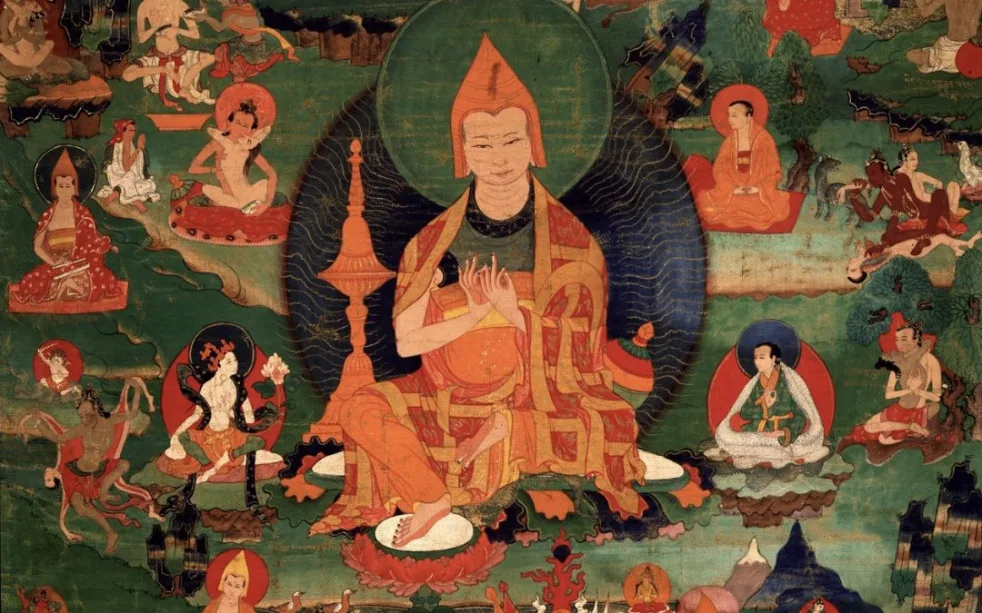
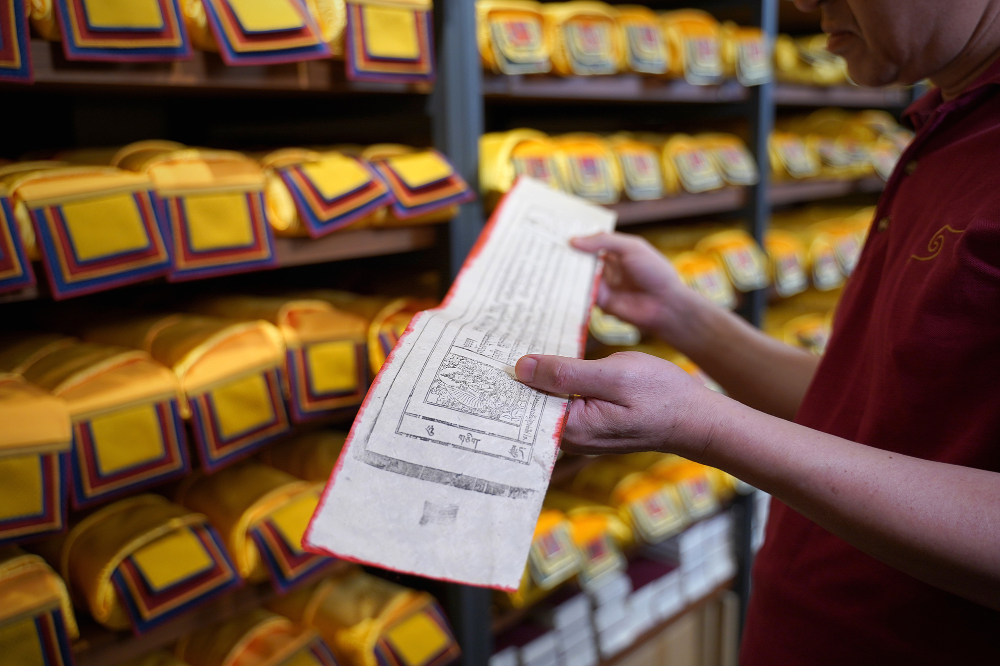

# Personal musings

##### Earth Touching

*“It is said that grief is actually love 一 but with nowhere to go,”* writes Ocean Vuong in the introduction of the 2022 edition of *Call Me By My True Names*. Thich Nhat…

Thich Nhat Hahn

Jan 1, 1993

##### Mind training

The source of this mind training (Tib.lojong) practice was the great Bengali master, Atisha Dipankara. Later, Geshe Chekawa organized these teachings into this series of 59…

Judith L. Lief

Jan 1, 2021

##### Selected scriptures and treatises

There are thousands of Buddhist texts, spanning many vehicles, disciplines and traditions. Translating these texts in an ongoing endeavour. Below is a selection of websites…

##### Tantra in Indonesia

[A story to tell on the](../musings/indonesia.llms.md) [:Borobudur](https://en.wikipedia.org/wiki/Borobudur), the [:Prajnaparamita of Java](https://en.wikipedia.org/wiki/Prajnaparamita_of_Java) and how…

##### Timeline of the Kangyur

The Kangyur is the collection of the Buddha’s teachings and has been translated into different languages throughout history. It’s is a fascinating journey through time and…

Adarshah
